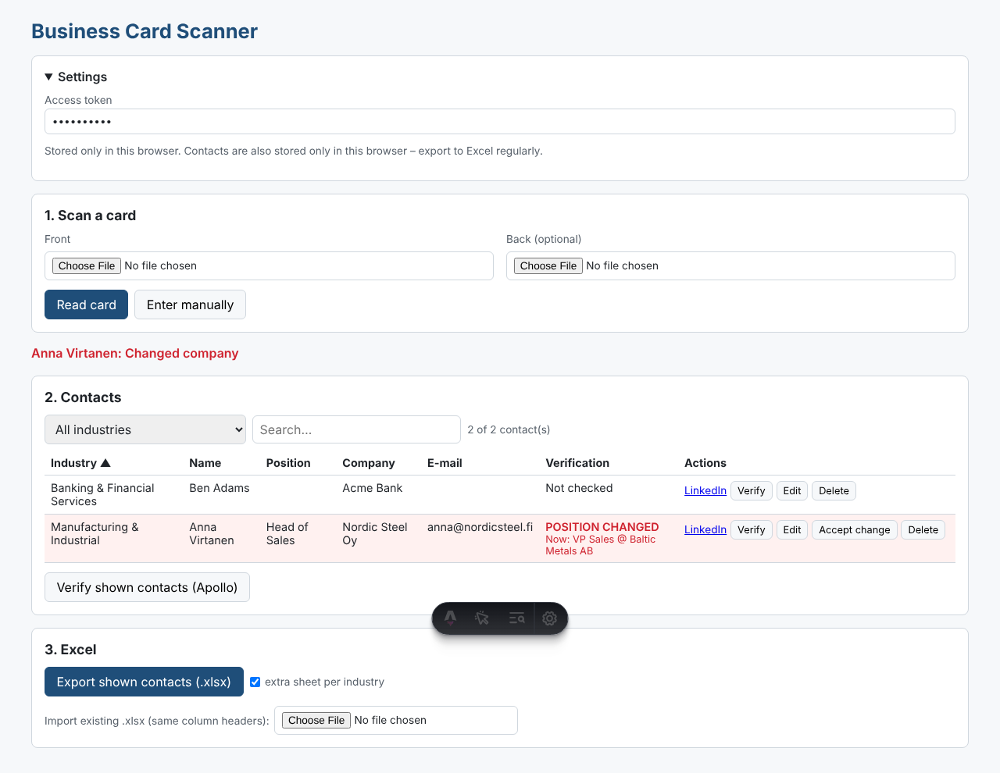

# Business Card Scanner

A web app at **`/card-scanner`** (part of this Astro site) for scanning business cards into an Excel file.



## What it does

1. **Scan** – take a photo with your phone camera (front, optionally back). Claude reads the card and fills in
   first/last name, position, company, e-mail, phone, mobile, website, address and LinkedIn URL.
2. **Review** – you check the fields and pick an **Industry** (Claude suggests one; you can choose from the list or type your own).
3. **Contacts table** – sort by any column (default: industry), filter by industry, search.
4. **Verify positions**
   - **Verify (Apollo)** – looks the person up in Apollo.io and compares the current title/company with the card.
     Changes are highlighted in red ("POSITION CHANGED"); **Accept change** updates the contact.
   - **LinkedIn** – opens the person's LinkedIn profile (or a LinkedIn people search) so you can check manually.
     LinkedIn has no public API for profile lookups and automated scraping violates its terms, so this step is manual.
5. **Excel** – export to `.xlsx` (sheet "All Contacts" + optionally one sheet per industry; changed positions are
   highlighted). Previously exported files can be imported again (duplicates are skipped).

Contacts are stored **only in your browser** (localStorage). Export to Excel regularly as a backup.

### Excel columns

Industry · Company · First Name · Last Name · Title (Card) · Email · Phone · Mobile · Website · Address ·
LinkedIn URL · Notes · Scanned At · Verification Status · Current Title (Verified) · Current Company (Verified) ·
Verification Note · Verified At · Verification Source

## Setup

Three secrets are required (Cloudflare Worker secrets in production, `.dev.vars` locally – see `.dev.vars.example`):

| Secret | Purpose |
|---|---|
| `CARD_SCANNER_ACCESS_TOKEN` | Password you enter in the app's *Settings*. Without it the API refuses all requests, so strangers can't use your paid API keys. |
| `ANTHROPIC_API_KEY` | Reading the card images (console.anthropic.com). |
| `APOLLO_API_KEY` | Position verification (Apollo.io → Settings → API). Each lookup uses Apollo credits; API access depends on your Apollo plan. |

```bash
npx wrangler secret put CARD_SCANNER_ACCESS_TOKEN
npx wrangler secret put ANTHROPIC_API_KEY
npx wrangler secret put APOLLO_API_KEY
npm run deploy
```

Local: `cp .dev.vars.example .dev.vars`, fill in the values, `npm run dev`, open http://localhost:4321/card-scanner.

## Code

| File | |
|---|---|
| `src/pages/card-scanner.astro` | UI |
| `src/scripts/card-scanner/` | Browser logic (scan, table, storage, Excel import/export) |
| `src/pages/api/card-scanner/extract.ts` | Sends the photo to Claude, returns structured fields + suggested industry |
| `src/pages/api/card-scanner/verify.ts` | Apollo People Match lookup and change detection |
| `src/lib/card-scanner/` | Shared types, industry list, access check |
